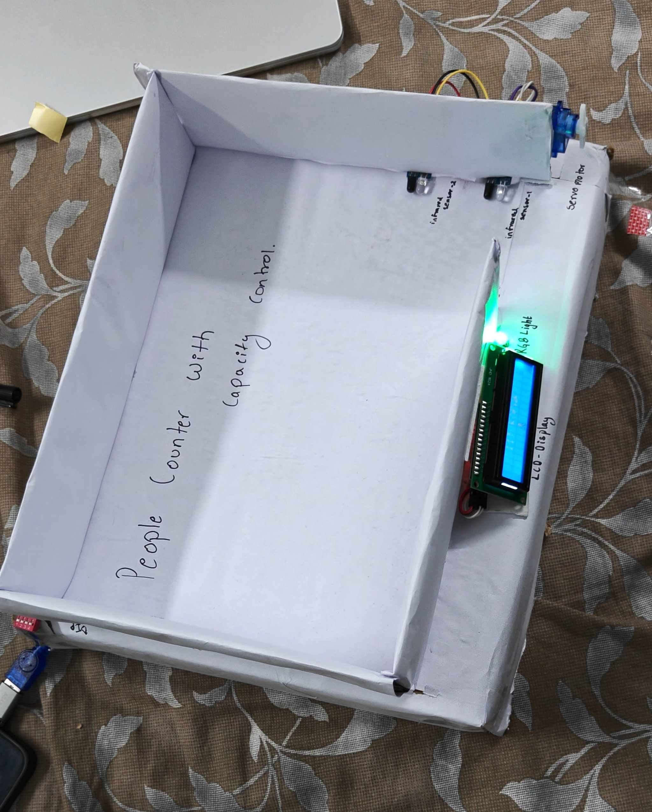

# Smart Room Occupancy Counter

An Arduino-based bidirectional people counter with capacity control, built at IIT Ropar. Two IR sensors detect whether a person is entering or leaving, the count is shown on an LCD, and a servo gate closes when the room is full.

## Features

- Counts people entering and leaving using two IR sensors (direction is found from which sensor triggers first)
- Room capacity (0 to 7, where 0 means no limit) is set with a DIP switch
- Servo gate closes when the room is full; entry is not counted and the buzzer beeps four times
- RGB LED fades from green (empty) through yellow to red (full) and blinks red when entry is denied
- Relay switches on only while at least one person is inside
- 16x2 I2C LCD shows "IIT ROPAR", the count against the capacity, and entry/exit animations
- Buzzer: 1 beep for entry, 2 for exit, 4 for denied entry, 3 for reset
- Push button resets the count to zero

## Components

| Component | Quantity |
|---|---|
| Arduino Uno R3 | 1 |
| IR obstacle sensor module | 2 |
| 16x2 LCD with I2C module | 1 |
| SG90 servo motor | 1 |
| 5V relay module (1 channel) | 1 |
| RGB LED (common anode) | 1 |
| Active buzzer | 1 |
| Push button | 1 |
| DIP switch (3 switches used) | 1 |
| Resistors (220 ohm) | 2 |
| Breadboard and jumper wires | as needed |

## Pin connections

| Component | Pin on component | Arduino pin |
|---|---|---|
| IR Sensor A | OUT | D2 |
| IR Sensor B | OUT | D3 |
| Reset push button | one leg (other leg to GND) | D4 |
| Active buzzer | + (other leg to GND) | D5 |
| Relay module | IN | D6 |
| RGB LED | green leg | D7 |
| RGB LED | blue leg (kept off) | D8 |
| RGB LED | red leg | A0 |
| RGB LED | common (longest) leg | 5V |
| Servo motor | signal | D9 |
| DIP switch (value 1) | one side (other side to GND) | D13 |
| DIP switch (value 2) | one side (other side to GND) | D12 |
| DIP switch (value 4) | one side (other side to GND) | D10 |
| LCD I2C module | SDA | A4 |
| LCD I2C module | SCL | A5 |

The LCD, IR sensors, relay and servo are powered from 5V and share a common GND with the Arduino. The RGB LED has a 220 ohm resistor on each colour leg.

## How it works

1. The two IR sensors are placed one behind the other along the walking path. Each output goes LOW when a person blocks its beam.
2. The Arduino saves the time at which each sensor triggers, using interrupts on D2 and D3.
3. If sensor A triggers before B, the person is entering and the count goes up. If B triggers first, the person is leaving and the count goes down (never below zero).
4. The DIP switches set the capacity. When the count reaches it, the servo closes the gate and further entries are not counted.
5. The RGB LED colour follows how full the room is, and the relay is on while the count is above zero.

## Getting started

1. Install the [Arduino IDE](https://www.arduino.cc/en/software).
2. Install the library **LiquidCrystal I2C** by Frank de Brabander (Sketch → Include Library → Manage Libraries). The `Servo` and `Wire` libraries come with the IDE.
3. Wire the circuit using the pin table above.
4. Open `people_counter.ino`, select **Arduino Uno** and the correct port, and click **Upload**.
5. Open the Serial Monitor at 9600 baud to see start-up messages (for example if the LCD is not found).

### Settings you may need to change in the code

| Setting | Default | Change it if |
|---|---|---|
| `COMMON_ANODE` | `true` | your RGB LED is common cathode |
| `RELAY_ACTIVE_LOW` | `true` | your relay works the other way round |
| `GATE_OPEN` / `GATE_CLOSED` | 90 / 0 | the gate arm moves the wrong way |

## Repository contents

- `people_counter.ino`: Arduino code
- `prototype.jpg`: photo of the working prototype
- Project report (PDF)

## Team

| Name | Entry number |
|---|---|
| GANGISHETTY SANJAY DEEP (Team Leader) | 2026AIB1035 |
| DHONNAR SATYAM RAMESH | 2026AIB1031 |
| DIVYANSHI | 2026AIB1032 |
| GAJJELA SRI CHARAN | 2026AIB1033 |
| GANDRAJUPALLI JATHIN BHARADWAJ | 2026AIB1034 |
